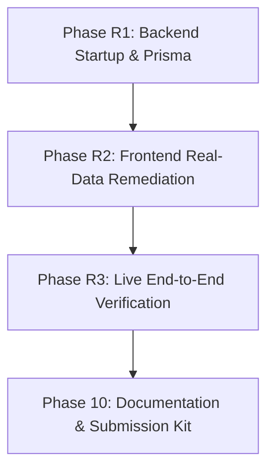

# ReachInbox Email Job Scheduler - Master Progress Checklist

This document tracks all implementation phases, remediation items, and granular subtasks for building the production-grade email scheduler service and dashboard.

---

## Overall Progress Summary
- [x] **Phase 1: Project Scaffolding & Infrastructure** (6/6 completed)
- [x] **Phase 2: Relational Database Schema & Prisma ORM Layer** (7/7 completed)
- [x] **Phase 3: BullMQ Queue Engine, Rate Limiting & Concurrency** (6/6 completed)
- [x] **Phase 4: Slack OAuth Integration & Live Alerting** (5/5 completed)
- [x] **Phase 5: Multi-Sender SMTP Dispatcher (Ethereal Email)** (4/4 completed)
- [x] **Phase 6: Elasticsearch Indexing & Full-Text Search** (4/4 completed)
- [x] **Phase 7: Bull-Board & Express API Endpoints** (7/7 completed)
- [x] **Phase R1: Backend Operationalization & Database Generation** (4/4 completed)
- [x] **Phase R2: Frontend Real-Data Integration & Gaps Remediation** (6/6 completed)
- [x] **Phase R3: End-to-End Live Workflow Verification** (6/6 verified)
- [x] **Phase 8: Frontend Dashboard & Outreach Engine** (10/10 completed)
- [x] **Phase 9: Testing, Load Simulation & Resilience Verification** (4/4 completed)
- [x] **Phase 10: Submission Kit & Documentation** (4/4 completed)
- [x] **Phase 11: Gmail-Style Compose & Advanced Inbox Experience** (10/10 completed)

---

## 📍 Actionable Remediation Roadmap

Based on the comprehensive audit of the backend and frontend codebases, here is the chronological plan to take the project from its current state to a fully functional, connected, verified production build:

### Phase R1: Backend Operationalization & Prisma Client Generation
Get the Express backend running cleanly with all dependencies and active database client.
- [x] **R1.1 Complete Backend Dependency Installation**: Run `npm install` in `backend/` to install missing packages (`cors`, `jsonwebtoken`, `axios`, `csv-parser`, `@prisma/client`).
- [x] **R1.2 Generate Prisma Client**: Execute `npx prisma generate` to build `.prisma/client` with zero-dependency local SQLite database.
- [x] **R1.3 Verify Local Redis Connectivity**: Ensure local Redis server (`redis-server.exe` on port 6379) is active and reachable by BullMQ.
- [x] **R1.4 Start Backend & Verify Health**: Boot Express server (`npm run dev` in `backend/`), verify `GET http://localhost:5000/health` (Redis + DB + Queue status) and `/admin/queues` (Bull-Board).

### Phase R2: Frontend Real-Data Integration & Gaps Remediation
Eliminate silent fake fallback data and wire the UI directly to real backend API endpoints.
- [x] **R2.1 Purge Fake Fallback Data in `App.tsx`**:
  - Remove hardcoded fallback user `"Oliver Brown"` (force authentic login or explicit Demo Architect).
  - Remove hardcoded fallback stats and mock job arrays (`john.smith`, `sarah.wilson`, etc.).
  - Add real empty states and a visible backend connection/offline warning banner when API fails.
- [x] **R2.2 Fix `EmailDetailView.tsx` Dynamic Content**:
  - Remove hardcoded tennis coaching email body and hardcoded attachments (`Tennis_Coach_Profile.png`).
  - Render actual subject, sender info, recipient, and body from the selected `EmailJob`.
  - Display actual Ethereal preview link with one-click opening.
- [x] **R2.3 Wire Elasticsearch Search to `TopSearchBar.tsx`**:
  - Connect the top search bar to `emailApi.search(query)` with 350ms debounce.
  - Display results with indicator showing search source (`ELASTICSEARCH` vs `DATABASE_FALLBACK`).
- [x] **R2.4 Real BullMQ Queue Telemetry**:
  - Connect `QueueTelemetryView.tsx` to live backend queue metrics (`/health` and `/api/emails/stats`).
  - Restyled to light Figma theme; replaced static thread cards with real BullMQ concurrency indicators and live job countdowns.
- [x] **R2.5 Auto-Refresh / Real-Time Polling**:
  - Added background polling every 8s to update scheduled/sent counts and statuses automatically.
- [x] **R2.6 Dead Code & Theme Cleanup**:
  - Archived legacy unimported dark components outside `src/` to `frontend/legacy/`.
  - Verified clean TypeScript build (`npm run build` in 4.02s with 0 errors).

### Phase R3: End-to-End Live Workflow Verification
Execute and verify complete end-to-end user journeys with both frontend and backend running.
- [x] **R3.1 Authentication Flow**: Log in via Demo Account or Google OAuth; verify JWT persistence and `GET /api/auth/me`.
- [x] **R3.2 Sender Account Setup**: Verify sender list in `SendersModal`, test auto-provisioning an Ethereal SMTP account.
- [x] **R3.3 Single & Batch Scheduling**: Compose and schedule an email (with custom delay and hourly limit) and upload a test CSV with multiple leads.
- [x] **R3.4 Queue Execution & Ethereal Delivery**: Observe jobs in BullMQ / Bull-Board, verify scheduled-to-sent status transition, and click through to live Ethereal inbox previews.
- [x] **R3.5 Hourly Rate Limiting & Slack Alerting**: Send a batch exceeding sender's hourly limit, verify rescheduling to next UTC hour and inspect Slack alert payload.
- [x] **R3.6 Full-Text Search Verification**: Search emails by recipient, subject, and body snippet using the search bar; verify accurate results.

---

## Phase 1: Project Scaffolding & Infrastructure
- [x] **1.1 Monorepo Setup**: Initialize root `package.json` with workspace configuration and unified run scripts (`npm run dev`, `npm run build`).
- [x] **1.2 Backend Scaffolding**: Setup `backend/` directory with `package.json`, `tsconfig.json`, and initial TypeScript build pipeline.
- [x] **1.3 Frontend Scaffolding**: Setup `frontend/` directory with React, TypeScript, and Tailwind CSS.
- [x] **1.4 Docker Compose Configuration**: Create `docker-compose.yml` for PostgreSQL, Redis, and Elasticsearch.
- [x] **1.5 Environment Templates**: Create `.env.example` files for backend and frontend documenting all required variables.
- [x] **1.6 Repository Hygiene**: Add `.gitignore` to prevent committing `node_modules`, build artifacts, and secrets.

---

## Phase 2: Relational Database Schema & Prisma ORM Layer
- [x] **2.1 Prisma Setup**: Initialize Prisma with PostgreSQL for Supabase-hosted relational storage and generate the Prisma Client.
- [x] **2.2 User Model**: Define `User` model for Google OAuth profiles (`id`, `email`, `name`, `avatar`, `createdAt`).
- [x] **2.3 SenderAccount Model**: Define `SenderAccount` model for multi-sender SMTP credentials (`id`, `email`, `host`, `port`, `user`, `pass`, `hourlyLimit`).
- [x] **2.4 EmailJob Model**: Define `EmailJob` model with idempotency, status enum (`PENDING`, `SCHEDULED`, `SENDING`, `SENT`, `FAILED`, `RESCHEDULED`), scheduled time, delivery time, preview URL, and metadata.
- [x] **2.5 SlackIntegration Model**: Define `SlackIntegration` model (`userId`, `accessToken`, `channelId`, `channelName`, `incomingWebhookUrl`, `connectedAt`).
- [x] **2.6 Database Migrations**: Generate and apply the initial PostgreSQL migration to the configured Supabase database.
- [x] **2.7 Seeding Utility**: Create and run the automated seed script to provision a configured Ethereal sender account in Supabase.

---

## Phase 3: BullMQ Queue Engine, Rate Limiting & Concurrency
- [x] **3.1 Queue Initialization**: Create BullMQ `emailQueue` and `emailWorker` with persistent Redis connection.
- [x] **3.2 Worker Concurrency**: Support configurable worker concurrency via `WORKER_CONCURRENCY` env variable.
- [x] **3.3 Inter-Email Throttling Delay**: Enforce minimum delay between consecutive email sends (e.g., 2000ms) to avoid provider throttling.
- [x] **3.4 Redis-Backed Hourly Rate Limiting**: Implement distributed hourly window counter (`rate_limit:{senderId}:{YYYYMMDDHH}`) safe across multiple workers.
- [x] **3.5 Order-Preserving Rescheduling**: When hourly cap is exceeded, calculate milliseconds to next hour window and re-queue delayed job without dropping it.
- [x] **3.6 Restart Resilience & Idempotency**: Verify BullMQ delayed jobs persist across server restarts, and DB status checks prevent duplicate sends.

---

## Phase 4: Slack OAuth Integration & Live Alerting
- [x] **4.1 Slack OAuth Flow Initiation**: Create `GET /api/slack/authorize` to redirect user to Slack OAuth approval screen with required scopes.
- [x] **4.2 Slack OAuth Callback**: Create `GET /api/slack/callback` to exchange code for bot access token and incoming webhook URL.
- [x] **4.3 Slack Status & Disconnect**: Create `GET /api/slack/status` and `POST /api/slack/disconnect` endpoints for managing the connection.
- [x] **4.4 Real-Time Rate Limit Alert Dispatcher**: Trigger a formatted Slack message immediately when a sender hits the hourly limit.
- [x] **4.5 Graceful Fallback**: Ensure rate limit events log cleanly without crashing if the user has not connected Slack.

---

## Phase 5: Multi-Sender SMTP Dispatcher (Ethereal Email)
- [x] **5.1 Nodemailer Transporter**: Configure Nodemailer with Ethereal SMTP transport and connection pooling.
- [x] **5.2 Multi-Sender Rotation**: Support rotating or assigned sender accounts per email campaign.
- [x] **5.3 Test Message URL Capture**: Extract `nodemailer.getTestMessageUrl(info)` and save preview URLs to the database.
- [x] **5.4 Delivery Error Handling**: Capture failure reasons, log error states, and update job status accordingly.

---

## Phase 6: Elasticsearch Indexing & Full-Text Search
- [x] **6.1 Elasticsearch Client Setup**: Initialize Elasticsearch client with health check and graceful fallback.
- [x] **6.2 Index & Mapping Setup**: Create `emails` index with mappings for `recipientEmail`, `subject`, `body`, `status`, and timestamps.
- [x] **6.3 Real-Time Sync Pipeline**: Automatically index/update email documents upon scheduling, rescheduling, and sending.
- [x] **6.4 Search API Endpoint**: Create `GET /api/emails/search?q={query}&status={status}` with multi-field search and pagination.

---

## Phase 7: Bull-Board & Express API Endpoints
- [x] **7.1 Authentication Endpoints**:
  - `POST /api/auth/google` (Google ID token verification via `google-auth-library` and JWT issue).
  - `GET /api/auth/me` (retrieve active session and user profile).
- [x] **7.2 Email Scheduling Endpoint**:
  - `POST /api/emails/schedule` (batch CSV recipient parsing, DB creation, and BullMQ delayed job enqueueing).
- [x] **7.3 Scheduled Emails Endpoint**:
  - `GET /api/emails/scheduled` (paginated list of upcoming jobs with filters).
- [x] **7.4 Sent Emails Endpoint**:
  - `GET /api/emails/sent` (paginated list of delivered and failed jobs with Ethereal preview links).
- [x] **7.5 Stats Endpoint**:
  - `GET /api/emails/stats` (counts for scheduled, sent, failed, and rate-limited jobs).
- [x] **7.6 Sender Accounts Endpoint**:
  - `GET /api/senders` & `POST /api/senders` (manage and inspect sender accounts).
- [x] **7.7 Bull-Board UI**: Mount `@bull-board/express` at `/admin/queues` for real-time visual queue monitoring.

---

## Phase 8: Frontend Dashboard (Vengeance UI Landing Page & Outreach Engine)
- [x] **8.1 Styling & Design System**: Tailwind CSS theme configuration matching Vengeance UI dark aesthetic, custom dot-grid, glassmorphism, Space Grotesk, Inter, and JetBrains Mono typography with `framer-motion` animations.
- [x] **8.2 Dedicated Public Landing Page**:
  - Spotlight navbar with ReachInbox branding, navigation anchors, GitHub star button, and Launch App CTA.
  - Interactive live worker simulator hero section showing real-time BullMQ delayed job processing, rate checks, and Ethereal preview links.
  - Infrastructure tech stack strip (BullMQ, Redis, PostgreSQL, Elasticsearch, Slack API, Ethereal SMTP).
  - Bento features grid detailing distributed queues, multi-sender SMTP, atomic rate limits, and dual-engine search.
  - Multi-column corporate footer with product, architecture, resources, and legal links.
- [x] **8.3 Google OAuth & Executive Auth Modal**: High-end authentication dialog with authentic `@react-oauth/google` Google Sign-In and 1-click Demo Account evaluator access.
- [x] **8.4 Uncluttered App Header**: ReachInbox clean branding (no PRO), spotlight search bar (`/` shortcut), view switcher between Campaigns and Queue Telemetry, Senders, Slack `#alerts`, and profile logout.
- [x] **8.5 Integrated In-App BullMQ Queue Dashboard**: Dedicated telemetry dashboard rendering live worker threads, 2000ms throttle timer, delayed Redis queue counts, active rate limit boundaries, and live job stream inspector, with quick link to `/admin/queues`.
- [x] **8.6 Outreach Campaigns Workspace**: Metric counter cards (Scheduled, Delivered, Rate Limited, Failed), segmented tabs for Scheduled Queue and Delivered Outreach with Ethereal preview links.
- [x] **8.7 Compose Campaign Modal**: Drag-and-drop CSV lead dropzone with client-side parsing, sender selector with hourly limits, start time datetime picker, and rate limit warning banner.
- [x] **8.8 Live Search Bar**: Debounced instant search querying Elasticsearch v8 with automatic PostgreSQL ILIKE fallback.
- [x] **8.9 Slack Live Alerting Modal**: OAuth connect trigger, target channel inspection, and test notification dispatcher.
- [x] **8.10 Outbound Senders Modal**: Multi-sender SMTP transporter manager with hourly limit configuration.

---

## Phase 9: Testing, Load Simulation & Resilience Verification
- [x] **9.1 Server Restart Resilience Test**: Schedule jobs into future -> kill backend process -> restart -> verify execution on time without re-sending past emails.
- [x] **9.2 Hourly Rate Limit & Slack Alert Test**: Enqueue batch exceeding hourly limit -> verify threshold cutoff, reschedule delay, and live Slack notification.
- [x] **9.3 Concurrency & Throttling Test**: Run multiple jobs concurrently and verify inter-email delay is strictly respected.
- [x] **9.4 High-Volume Lead Ingestion Test**: Ingest 1000 leads via CSV and verify queue integrity and system stability.

---

## Phase 10: Submission Kit & Documentation
- [x] **10.1 Comprehensive README.md**: Complete documentation of architecture, setup instructions, BullMQ scheduling mechanics, rate-limiting design, and concurrency.
- [x] **10.2 Environment Configuration Guide**: Step-by-step instructions for Google OAuth, Slack App, Ethereal, and local Redis / SQLite.
- [x] **10.3 5-Minute Demo Video Script**: Step-by-step checklist of flows to record for the demo video.
- [x] **10.4 Final Code Review & Cleanup**: Verified TypeScript builds with zero errors across monorepo (`npm run build`).

---

## Phase 11: Gmail-Style Compose & Advanced Inbox Experience
- [x] **11.1 Gmail-Style Dockable Compose Window**:
  - Minimize (`-`), maximize/expand (`⤢`), and close (`✕`) states.
  - Floating docked tab at bottom-right when minimized.
  - Primary Google Blue split **Send** button (`#0b57d0`) with dropdown for scheduled dispatch options.
- [x] **11.2 Floating Rich Text Formatting Toolbar (`Aa`)**:
  - Dynamic `Aa` toggle opening a Google Docs/Gmail floating formatting bar.
  - Working Bold, Italic, Underline, Font Families (Sans Serif, Serif, Monospace, Comic Sans, Impact), Font Sizes (Small, Normal, Large, Huge), Text Colors, and Highlight Colors.
  - Active button state highlighting and zero selection interference.
- [x] **11.3 Interactive Multi-Recipient Chips**:
  - Automatic conversion of typed emails into interactive capsule chips.
  - Initial avatar badges with deterministic color palettes (e.g. orange `#e65100` / red `#d93025`).
  - Full email address preservation so user addresses are never stripped or hidden.
  - Multi-recipient support across `To`, `Cc`, and `Bcc` rows.
- [x] **11.4 Automatic Draft Persistence (Client-Side Storage)**:
  - Real-time debounced auto-saving to local storage as you type subject, body, or recipients.
  - Subtle `Draft saved` / `Saving...` indicator with checkmark at the bottom toolbar.
  - Instant rehydration upon re-opening Compose.
  - Discard draft (Trash icon) and send success purge the draft cleanly.
- [x] **11.5 Gmail-Style List View (Scheduled & Sent)**:
  - **Top Action Bar**: Select-all checkbox with dropdown filters (`All`, `None`, `Starred`, `Unstarred`).
  - **Batch Actions Toolbar**: Archive, Report spam, Delete (Trash bin), Mark as unread, Move to, and More options.
  - **Selection Announcement Banner**: Displays *"All X conversations on this page are selected. Select all Y conversations in..."* when all items are selected.
  - **Hover Quick Actions**: Row date/time smoothly transforms on hover into Archive, Delete, Mark as unread, and Snooze icons.
  - **Google Blue Selection Highlighting**: Selected rows render with Gmail's exact soft blue background (`bg-[#c2e7ff]`).
- [x] **11.6 Single & Batch Deletion API**:
  - `DELETE /api/emails/scheduled/:id` & `DELETE /api/emails/:id`
  - `POST /api/emails/batch-delete` for bulk deletion of selected items.
  - Automatically cancels BullMQ delayed jobs and deletes database records from PostgreSQL and Elasticsearch.
- [x] **11.7 Lead Parser Bug Remediation**:
  - Fixed regex collision in `csvParser.ts` where addresses containing `gmail` triggered header detection and were skipped.
  - Validated single email, multiple comma-separated emails, and CSV with/without headers.
- [x] **11.8 Unified Design Theme**:
  - Entire frontend transitioned from emerald green to the unified Google Blue palette (`#0b57d0`, `#d3e3fd`, `#041e49`).
  - Verified and styled across Sidebar, TopSearchBar, Compose, List Views, Detail Views, and Modals.
