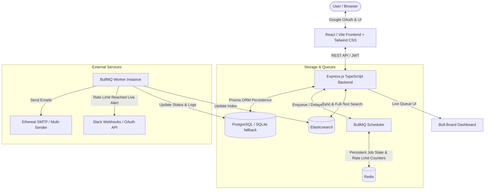

# 🚀 ReachInbox Full-Stack Email Job Scheduler – Master Implementation Plan

This master plan details the architecture, design choices, and phase-by-phase execution roadmap to build a production-grade Email Scheduler & Dashboard from scratch according to all requirements.

---

## 🏗 System Architecture

---

## 📋 Phase-Wise Implementation Roadmap

### 🔹 Phase 1: Project Scaffolding & Infrastructure
- **Monorepo Structure**:
  - `backend/`: Node.js, Express.js, TypeScript, BullMQ, Prisma, Elasticsearch client, Nodemailer.
  - `frontend/`: React, TypeScript, Tailwind CSS, Lucide icons, Google OAuth (@react-oauth/google).
  - Root `package.json` for streamlined commands (`npm run dev`, `npm run build`).
- **Containerized Infra (`docker-compose.yml`)**:
  - **PostgreSQL**: Relational storage for users, sender accounts, email jobs, and integration tokens.
  - **Redis**: Persistent queue store for BullMQ and atomic distributed rate-limiting counters.
  - **Elasticsearch**: Full-text search engine for sent/scheduled emails.
- **Environment Configuration**:
  - Comprehensive `.env.example` templates covering all services.

---

### 🔹 Phase 2: Relational Database Schema & Prisma ORM Layer
- **Data Models (`prisma/schema.prisma`)**:
  - `User`: Google profile (`id`, `email`, `name`, `avatar`, `createdAt`).
  - `SenderAccount`: Multi-sender support (`id`, `name`, `email`, `host`, `port`, `user`, `pass`, `hourlyLimit`).
  - `EmailJob`:
    - `id`, `idempotencyKey` (prevents duplicate enqueuing)
    - `userId`, `senderId`, `recipientEmail`, `subject`, `body`
    - `scheduledAt`, `sentAt`, `status` (`PENDING`, `SCHEDULED`, `SENDING`, `SENT`, `FAILED`, `RESCHEDULED`)
    - `attempts`, `etherealMessageUrl`, `errorMessage`, `metadata`
  - `SlackIntegration`:
    - `userId`, `slackTeamId`, `accessToken`, `channelId`, `channelName`, `incomingWebhookUrl`, `connectedAt`
- **Database Migrations & Test Account Seeding**:
  - Automated provisioning of test Ethereal sender accounts.

---

### 🔹 Phase 3: BullMQ Queue Engine, Rate Limiting & Concurrency
- **Queue & Worker Architecture**:
  - Dedicated `emailQueue` and `emailWorker` using BullMQ.
  - **Configurable Worker Concurrency**: Set via `WORKER_CONCURRENCY` (e.g., 5 or 10 concurrent jobs).
  - **Inter-Email Delay**: Configurable minimum delay (e.g., 2000ms between sends) to prevent SMTP provider throttling.
- **Distributed Hourly Rate Limiter (Redis-Backed)**:
  - Redis key: `rate_limit:{senderId}:{YYYYMMDDHH}`.
  - Atomic increment with TTL (expires after the 1-hour window).
  - Multi-worker safe across clustered instances without in-memory race conditions.
- **Graceful Rescheduling (Non-Dropping)**:
  - When hourly threshold is met:
    - Compute exact milliseconds until next hour window starts (`nextWindowDelay = msToNextHour()`).
    - Delay/re-schedule job for the next window (`job.moveToDelayed(nextWindowDelay)`).
    - Update database status to `RESCHEDULED`.
    - **Trigger live Slack notification** (Phase 4).
    - Preserves execution order without dropping jobs.
- **Restart Resilience & Idempotency**:
  - BullMQ stores delayed jobs natively in Redis sorted sets (`zset`).
  - On backend restart, Redis retains upcoming schedules.
  - Idempotency checks guarantee an email marked `SENT` is never duplicated.

---

### 🔹 Phase 4: Slack OAuth Integration & Live Alerting
- **OAuth Flow**:
  - `/api/slack/authorize`: Initiates OAuth authorization flow with Slack (`incoming-webhook`, `chat:write`).
  - `/api/slack/callback`: Exchanges OAuth authorization code for webhook URL & bot token; stores to user's `SlackIntegration`.
  - `/api/slack/status`: Returns current Slack connection status and target channel name.
  - `/api/slack/disconnect`: Gracefully unlinks integration without affecting scheduling.
- **Live Rate Limit Alert Dispatcher**:
  - Fires at the exact millisecond an hourly limit is breached.
  - Formatted Slack message includes:
    - ⚠️ **Rate Limit Alert**: Sender reached hourly limit.
    - 📊 **Current Count**: e.g., 50/50 emails sent.
    - ⏳ **Rescheduled**: Remaining jobs deferred to next window.
    - Graceful fallback: If Slack not connected, log event silently without crashing.

---

### 🔹 Phase 5: Multi-Sender SMTP Dispatcher (Ethereal Email)
- **Multi-Sender Management**:
  - Ability to register multiple Ethereal sender accounts or auto-provision on boot.
  - Multi-sender cycling / campaign-specified sender assignment.
- **Email Delivery & Preview Generation**:
  - Uses `nodemailer` with Ethereal SMTP transporter.
  - Retrieves preview URL via `nodemailer.getTestMessageUrl(info)`.
  - Stores the URL in `EmailJob.etherealMessageUrl` for direct one-click preview in frontend dashboard.

---

### 🔹 Phase 6: Elasticsearch Indexing & Full-Text Search
- **Elasticsearch Client Setup**:
  - Connects to Elasticsearch cluster.
  - Auto-creates index `emails` with appropriate analyzers (wildcard/ngram on recipient, subject, body).
- **Synchronization Pipeline**:
  - Index document when email is scheduled.
  - Update document status and timestamps when sent, failed, or rescheduled.
- **Search API Endpoint**:
  - `GET /api/emails/search?q={query}&status={status}&page={page}`:
    - Multi-match query across `recipientEmail`, `subject`, and `body`.

---

### 🔹 Phase 7: Bull-Board & Express API Endpoints
- **Authentication & User Routes**:
  - `POST /api/auth/google`: Verifies Google ID Token (`google-auth-library`), returns JWT session.
  - `GET /api/auth/me`: Current user session and connected integrations.
- **Email Scheduling & Job Routes**:
  - `POST /api/emails/schedule`:
    - Handles subject, body, lead recipient list (from CSV parser), start time, inter-email delay, and hourly limit.
    - Performs atomic DB write + BullMQ batch delayed job enqueuing.
    - Synchronizes initial records to Elasticsearch.
  - `GET /api/emails/scheduled`: Fetches upcoming jobs with pagination.
  - `GET /api/emails/sent`: Fetches sent and failed jobs with pagination and preview URLs.
  - `GET /api/emails/stats`: Real-time analytics (counts of scheduled, sent, failed, rate-limited).
- **Queue Monitoring UI**:
  - Mounts `@bull-board/express` at `/admin/queues` showing active, delayed, waiting, and completed jobs in real-time.

---

### 🔹 Phase 8: Frontend Dashboard (Figma-Matched UI)
- **Tech Stack & Design System**:
  - React (Vite / Next.js) with Tailwind CSS matching the provided Figma design.
  - Typography, clean micro-interactions, dark/light theme fidelity.
- **Google OAuth Authentication**:
  - Real Google Login button (`@react-oauth/google`).
  - Top header displaying: User Name, Email, Avatar, and Logout action.
- **Dashboard Layout & Navigation**:
  - Header with user profile and "Connect Slack" / "Slack Connected" status indicator.
  - Quick action: "Compose New Email" primary button and Bull-Board queue monitor link.
  - Tab navigation: **Scheduled Emails** and **Sent Emails**.
  - Elasticsearch live search input with instant debounced filtering.
- **"Compose New Email" Modal/Drawer**:
  - Subject input & Rich/Markdown Email Body editor.
  - CSV / Text lead file dropzone:
    - Instant client-side parsing of email addresses.
    - Displaying validated lead count badge (e.g., "150 leads detected").
  - Scheduling Parameters:
    - Start Time (datetime picker).
    - Delay between emails (seconds).
    - Hourly limit input.
  - Submit button with loading state, validation, and success toast.
- **Data Tables (Scheduled & Sent)**:
  - **Scheduled Emails Table**: Recipient Email, Subject, Scheduled Time, Status badge, Estimated Delivery.
  - **Sent Emails Table**: Recipient Email, Subject, Sent At, Status badge (Sent/Failed), "View in Ethereal" link button.
  - Graceful empty states and skeleton loading states.

---

### 🔹 Phase 9: Testing, Load Simulation & Resilience Verification
- **Persistence & Restart Verification**:
  - Schedule emails for future time.
  - Terminate backend process (`kill`).
  - Restart backend service.
  - Confirm jobs in BullMQ / Redis trigger on schedule without duplicates or resets.
- **Rate Limiting & Slack Notification Live Demo**:
  - Schedule 25 emails with an hourly limit of 5.
  - Verify first 5 send with configured delay.
  - Verify 6th job triggers rate limit, re-schedules to next hour window.
  - Verify live Slack notification arrives in user's Slack channel.
- **Concurrency & 1000+ Lead Stress Test**:
  - Ingest 1000 leads via CSV, verify BullMQ queue stability, worker concurrency, and zero memory leaks.

---

### 🔹 Phase 10: Submission Kit & Documentation
- **Comprehensive README.md**:
  - Quick start instructions (`docker compose up`, `npm install`, `npm run dev`).
  - Architecture breakdown and BullMQ persistent scheduling explanation.
  - Rate limiting & Redis sliding window documentation.
  - Slack OAuth app setup guide.
  - Ethereal SMTP configuration guide.
- **5-Minute Demo Video Script**:
  - Step-by-step checklist matching all criteria in the assignment rubric.
