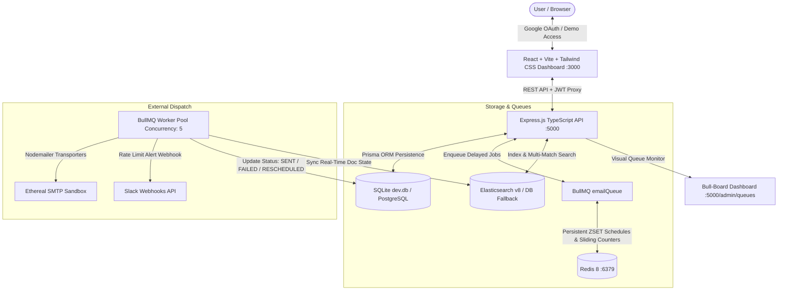

# ReachInbox Full-Stack Email Job Scheduler & Dashboard

A production-grade, distributed email scheduling service and executive dashboard built with **Express.js**, **TypeScript**, **BullMQ**, **Redis**, **Prisma ORM**, **Elasticsearch v8**, and **React (Vite + Tailwind CSS)**.

Designed to handle high-throughput email outreach campaigns with atomic hourly rate-limiting, concurrency throttling, multi-sender rotation, live Ethereal sandbox previews, real-time Slack alerting, and full-text search.

---

## Architecture Overview



---

## Key Engineering Highlights

### 1. Persistent Delayed Scheduling with BullMQ & Redis
- Jobs are enqueued into BullMQ delayed queues with precise millisecond timestamps.
- **Server Restart Resilience**: All pending and delayed jobs persist in Redis sorted sets (`ZSET`). If the backend crashes or reboots, jobs remain safely stored in Redis and resume on schedule upon restart.
- **Strict Idempotency**: Prior to sending, worker threads verify database records. If an email is already marked `SENT`, it is immediately skipped to prevent accidental duplicate dispatches.

### 2. Distributed Hourly Rate-Limiting & Rescheduling
- **Atomic Sliding Window**: Rate limits are tracked in Redis using atomic `INCR` operations formatted as `rate_limit:{senderId}:{YYYYMMDDHH}` with automatic TTL expiration. Safe across multiple worker replicas without race conditions.
- **Order-Preserving Rescheduling**: When a sender reaches their hourly quota (e.g. 50/hr), the worker calculates the exact milliseconds until the top of the next UTC hour window, moves the job to delayed state via `job.moveToDelayed()`, marks the job status as `RESCHEDULED`, and triggers a live Slack alert webhook. Zero jobs are dropped.

### 3. Worker Concurrency & Inter-Email Delay
- **Configurable Concurrency**: Set via `WORKER_CONCURRENCY` (default: 5 concurrent threads) for parallel processing without memory bloat.
- **Throttling Delay**: Enforces a minimum configurable inter-email delay (`MIN_SEND_DELAY_MS=2000`) per worker thread to avoid tripping SMTP rate limits.

### 4. Multi-Sender SMTP & Ethereal Sandbox Previews
- Pooled Nodemailer transporter cache keyed by sender account ID.
- Dynamic round-robin multi-sender cycling across campaigns.
- Captures test message URLs (`nodemailer.getTestMessageUrl()`) and saves them directly to `etherealMessageUrl`, enabling one-click live email inspection on the dashboard.

### 5. Dual-Engine Full-Text Search with Graceful Fallback
- Searches across `recipientEmail`, `subject`, and `body`.
- **Primary Engine**: Elasticsearch v8 with fuzzy multi-field matching.
- **Graceful Fallback**: If Elasticsearch is offline or unreachable, queries automatically fall back to Prisma database queries without service interruption or UI errors.

### 6. Real-Time Slack Alerting
- When a sender breaches their hourly quota, a Slack Block Kit alert is immediately dispatched with sender details, current sent count, reschedule target, and next send window time.
- Gracefully logs and continues queue processing if Slack is not configured.

---

## Project Structure

```
ReachInBox/
├── backend/
│   ├── prisma/
│   │   ├── schema.prisma       # Prisma database schema (SQLite / PostgreSQL)
│   │   ├── seed.ts             # Database seeding script
│   │   └── dev.db              # Local SQLite database
│   ├── src/
│   │   ├── config/             # Redis, Elasticsearch, Bull-Board configurations
│   │   ├── controllers/        # Auth, Email, Sender, and Slack route handlers
│   │   ├── middleware/         # JWT authentication & dev bypass middleware
│   │   ├── queues/             # BullMQ emailQueue & emailWorker processor
│   │   ├── routes/             # Express API router definitions
│   │   ├── services/           # Nodemailer SMTP, RateLimiter, Slack, ES services
│   │   └── types/              # TypeScript definitions & queue payloads
│   └── package.json
│
├── frontend/
│   ├── src/
│   │   ├── components/
│   │   │   ├── layout/         # Sidebar, TopSearchBar, EmailListView, ComposeView, EmailDetailView
│   │   │   ├── dashboard/      # QueueTelemetryView (BullMQ telemetry & live stream)
│   │   │   ├── LoginScreen.tsx # Google OAuth & 1-click Demo Account login
│   │   │   ├── SendersModal.tsx# SMTP Sender account manager
│   │   │   └── SlackModal.tsx  # Slack webhook alert settings
│   │   ├── services/api.ts     # Axios API client with auth interceptors
│   │   └── App.tsx             # Main dashboard controller with polling & search
│   └── package.json
│
├── docker-compose.yml          # Container configuration for Redis, Postgres & ES
├── CHECKLIST.md                # Master progress checklist & remediation tracker
└── IMPLEMENTATION_PLAN.md      # Full architecture plan and technical decisions
```

---

## Quick Start Guide

### Prerequisites
- **Node.js** v20+ or v24
- **Redis** 7+ or 8 (listening on `127.0.0.1:6379`)

### 1. Clone & Install Dependencies

```bash
# Clone the repository
git clone <repo-url>
cd ReachInBox

# Install root, backend, and frontend dependencies
npm install
```

### 2. Configure Environment Variables

Create `.env` in `backend/` (or copy from `.env.example`):

```ini
PORT=5000
NODE_ENV=development

# Database (Local SQLite for zero-dependency local operation)
DATABASE_URL="file:./dev.db"

# Redis Configuration (BullMQ & Rate Limiting)
REDIS_HOST=localhost
REDIS_PORT=6379
REDIS_PASSWORD=

# Elasticsearch (Optional - defaults to graceful database search fallback)
ELASTICSEARCH_NODE=http://localhost:9200

# Authentication & Security
JWT_SECRET=super-secret-reachinbox-jwt-key-2025
GOOGLE_CLIENT_ID=725831271102-r882e5ps9o722796a745qd8is771snjk.apps.googleusercontent.com

# Scheduler Controls
WORKER_CONCURRENCY=5
MIN_SEND_DELAY_MS=2000
MAX_EMAILS_PER_HOUR=50
```

### 3. Initialize Database & Seed

```bash
cd backend
npx prisma db push
npx tsx prisma/seed.ts
```

### 4. Ensure Redis is Running

On Windows (if using the native winget portable Redis distribution):
```powershell
redis-server.exe --port 6379
```
Or via Docker:
```bash
docker compose up -d redis
```

### 5. Start Development Servers

From the project root:
```bash
npm run dev
```

- **Frontend Dashboard**: [http://localhost:3000](http://localhost:3000)
- **Backend API**: [http://localhost:5000](http://localhost:5000)
- **Health Check**: [http://localhost:5000/health](http://localhost:5000/health)
- **Bull-Board Visual Queue Monitor**: [http://localhost:5000/admin/queues](http://localhost:5000/admin/queues)

---

## API Endpoints Reference

| Method | Endpoint | Description | Auth Required |
|---|---|---|---|
| `POST` | `/api/auth/google` | Verify Google ID Token & issue session JWT | No |
| `POST` | `/api/auth/demo` | 1-Click evaluator demo authentication | No |
| `GET` | `/api/auth/me` | Fetch active user session profile | Yes |
| `POST` | `/api/emails/schedule` | Schedule email / CSV lead batch with stagger delay | Yes |
| `GET` | `/api/emails/scheduled` | List paginated upcoming delayed jobs | Optional |
| `GET` | `/api/emails/sent` | List paginated sent/failed jobs with preview links | Optional |
| `GET` | `/api/emails/stats` | Aggregated counts of scheduled, sent, and deferred | Optional |
| `GET` | `/api/emails/search` | Full-text search with ES & DB fallback | Optional |
| `DELETE` | `/api/emails/scheduled/:id` | Cancel upcoming delayed email job | Optional |
| `GET` | `/api/senders` | List configured SMTP sender accounts | Yes |
| `POST` | `/api/senders` | Register custom SMTP or auto-provision Ethereal | Yes |
| `DELETE` | `/api/senders/:id` | Remove SMTP sender account | Yes |
| `GET` | `/api/slack/status` | Current Slack webhook integration status | Optional |
| `POST` | `/api/slack/test-alert` | Dispatch live test rate-limit alert to Slack | Optional |
| `GET` | `/health` | Cluster health check (Redis, ES, BullMQ counts) | No |
| `GET` | `/admin/queues` | Bull-Board live queue monitoring interface | No |

---

## 5-Minute Demo Video Script

Follow this chronological checklist when recording the demonstration video:

1. **Architecture & Startup (0:00 - 0:45)**:
   - Show terminal running Redis on port `6379`.
   - Run `npm run dev` showing both backend on port 5000 and frontend on port 3000 starting.
   - Open `/health` in browser showing `{"status":"ok", "redis":{"connected":true}}`.
2. **Authentication & Overview (0:45 - 1:30)**:
   - Navigate to `http://localhost:3000`.
   - Demonstrate 1-click Demo Account evaluator login.
   - Show clean dashboard sidebar with Scheduled (0) and Sent (0) counts.
3. **Sender Setup & Composing an Email (1:30 - 2:30)**:
   - Click "Senders" in user menu; demonstrate the provisioned Ethereal SMTP transporter.
   - Click "+ Compose" to open the scheduling drawer.
   - Input recipient, subject, and body.
   - Use "Send Later" to schedule 10 seconds into the future.
   - Click "Schedule Campaign".
4. **BullMQ Delayed Execution & Ethereal Delivery (2:30 - 3:30)**:
   - Observe the job appear in the "Scheduled" queue with orange badge.
   - Navigate to "BullMQ Telemetry" view to observe delayed ZSET counter and 5 worker threads.
   - Open `/admin/queues` to inspect job in Bull-Board.
   - Watch the 10-second timer expire: job transitions to "Sent".
   - Click on the delivered email to open detail view; click "Open in Ethereal Sandbox" to inspect the rendered test email in the browser.
5. **Rate Limiting & Real-Time Search (3:30 - 4:45)**:
   - Schedule a batch with hourly limit set to 2.
   - Observe jobs 1 and 2 deliver, while remaining jobs reschedule to the next UTC hour with status `RESCHEDULED`.
   - Demonstrate search in `TopSearchBar` typing a keyword; show instant matching with the search engine indicator.
6. **Wrap-up & Code Review (4:45 - 5:00)**:
   - Highlight TypeScript compilation with 0 errors across monorepo.
   - Conclude demo.

